# Fitness Tracker (Android)

A personal diet, walking, workout, sleep and water tracker with an AI coach, built in Material 3 Expressive and packaged as an Android app with [Capacitor](https://capacitorjs.com).

**[⬇ Download the latest APK](https://github.com/yashgumaste/fitness-tracker/releases/latest)** · Android 8.0 or newer · free, no account needed

  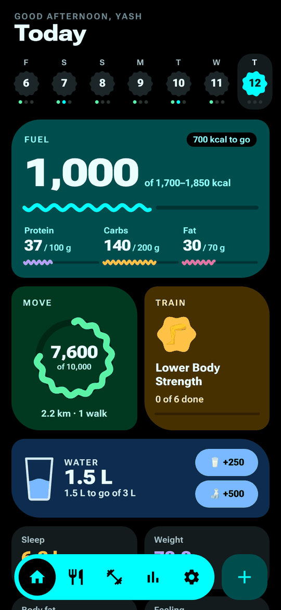&nbsp;
  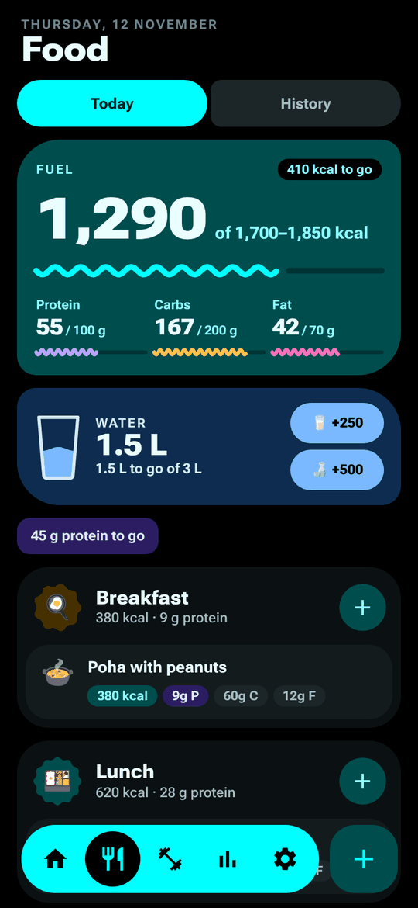&nbsp;
  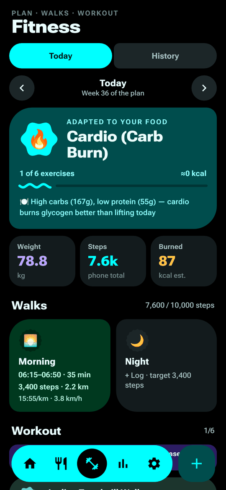&nbsp;
  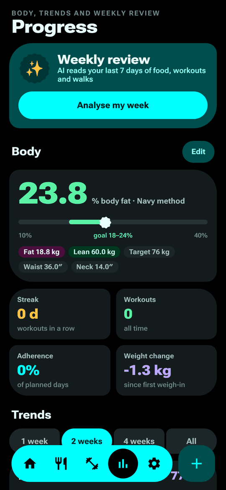

## Features

### Log anything in a couple of taps
Tap **+** to add food, water, a walk, sleep, weight, how you feel, or today's workout. To log food, describe the meal the way you'd say it. The AI splits it into items and works out the calories, protein, carbs and fat.

| Log menu | Food, written naturally | Water | Walk | Sleep |
|:-:|:-:|:-:|:-:|:-:|
| 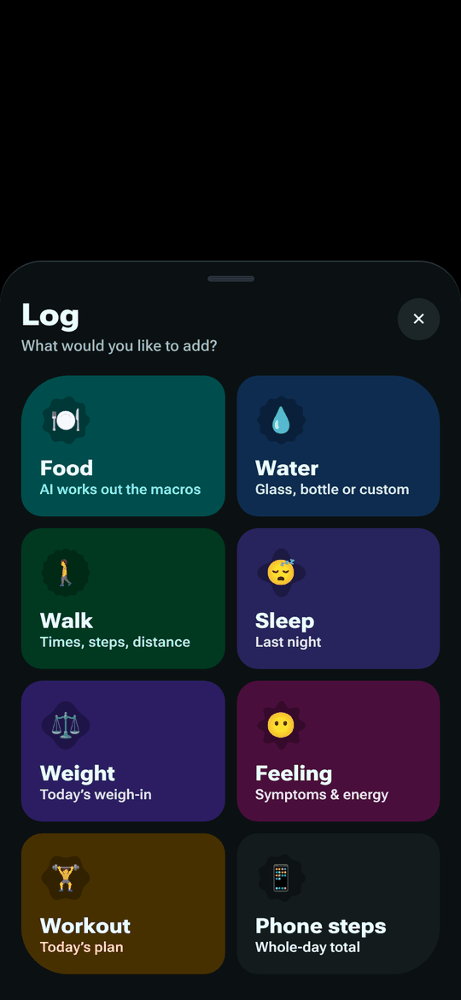 | 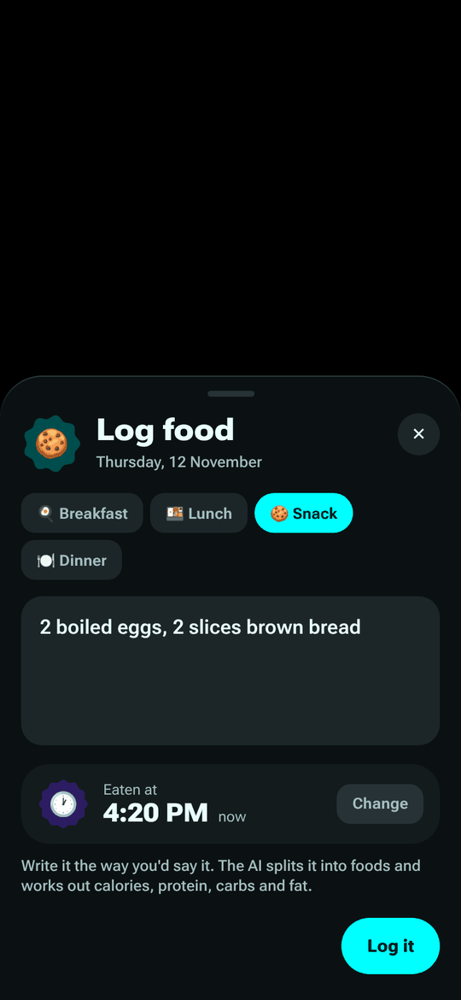 | 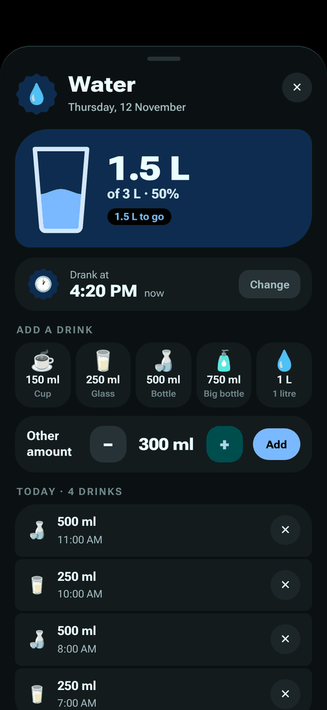 | 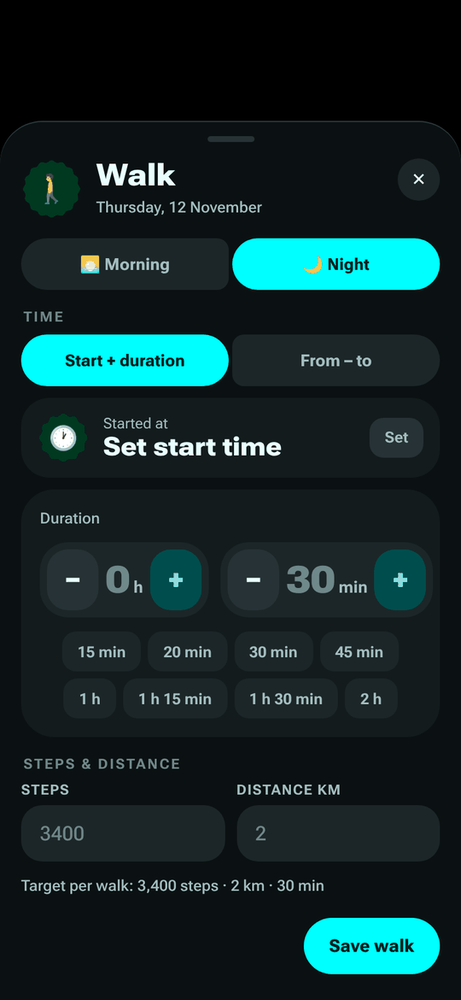 | 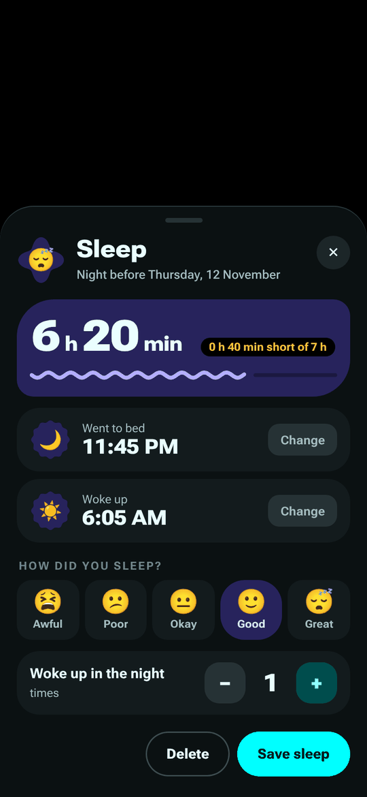 |

### Food and the AI coach
The Food page shows each meal of the day with its macros. The coach reads your day and tells you what to do next. History shows every past day.

| Today | Coach | History |
|:-:|:-:|:-:|
|  | 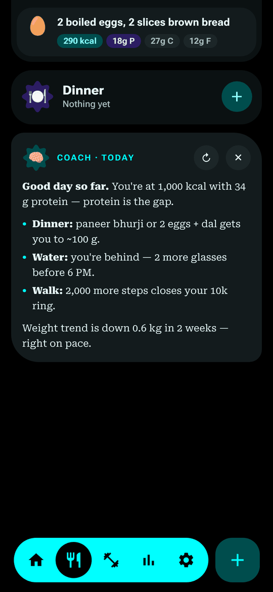 | 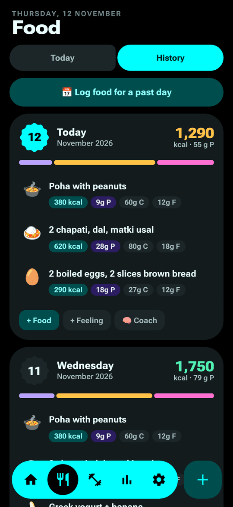 |

### Fitness and progress
The Fitness page shows a workout plan that adapts to what you ate, along with your walks and steps. History has day, week, month and year views. Progress covers body fat (US Navy method), your weight trend, and charts for steps, sleep and water, plus an AI weekly review.

| Fitness day | Week view | Progress | Trends |
|:-:|:-:|:-:|:-:|
|  | 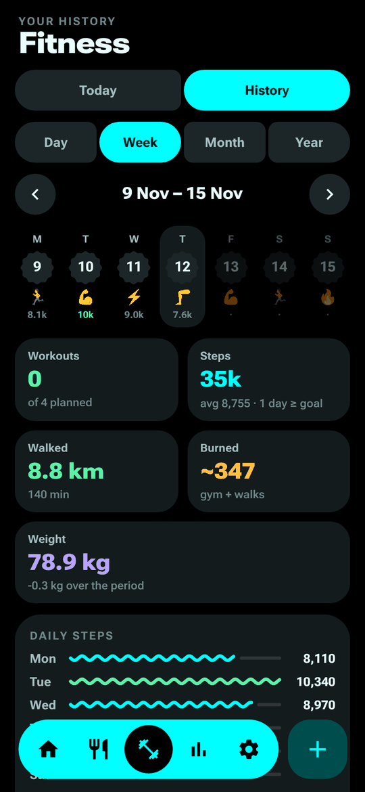 |  | 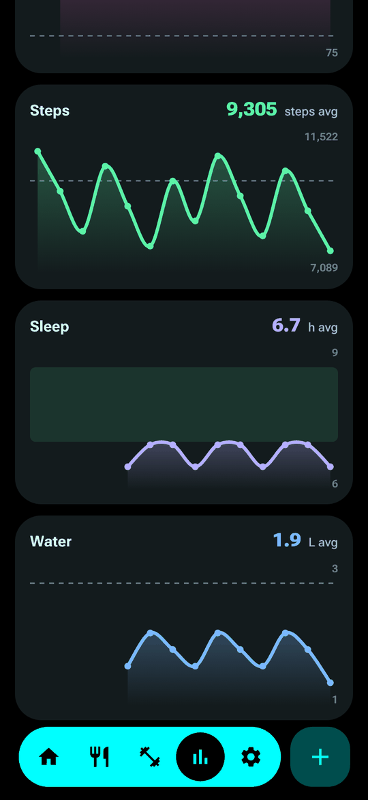 |

### Setup, settings and Health Connect
- **First-time setup:** a short multi-page setup suggests calorie, protein, step and water targets. Every page can be skipped.
- **Settings:** grouped by category.
- **AI:** works out of the box with a free Gemini key. You can switch to Claude with your own key instead.
- **Health Connect:** reads steps from the phone and shares meals (with macros), water, walks, workouts, weight and sleep with Google Health.

| Setup | Settings | AI | Health Connect |
|:-:|:-:|:-:|:-:|
| 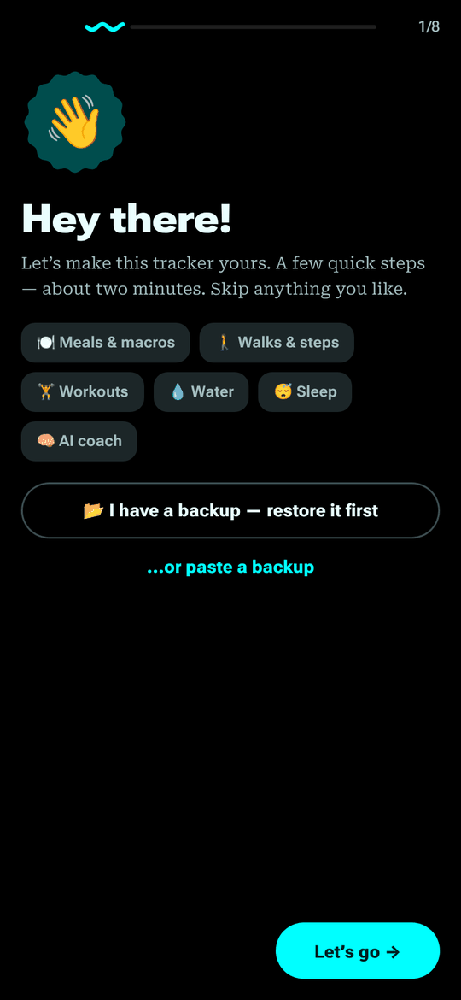 | 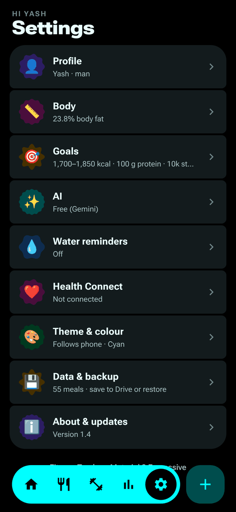 | 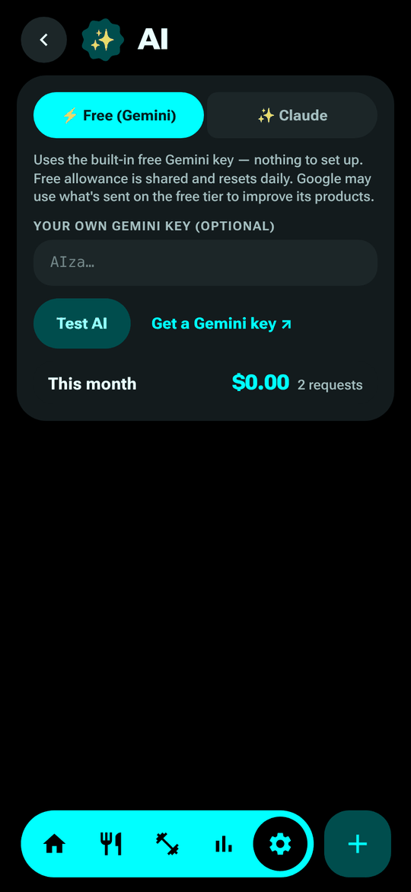 | 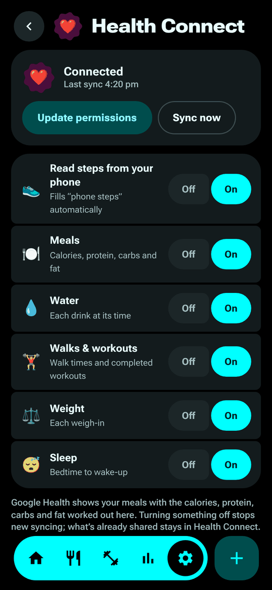 |

### Make it yours
Choose light, dark or the phone's theme. Pick one of 12 accent colours or make your own with a wheel, RGB, HSV or hex code. The app icon changes to match your accent.

| Light theme | Theme & colour | Colour picker |
|:-:|:-:|:-:|
| 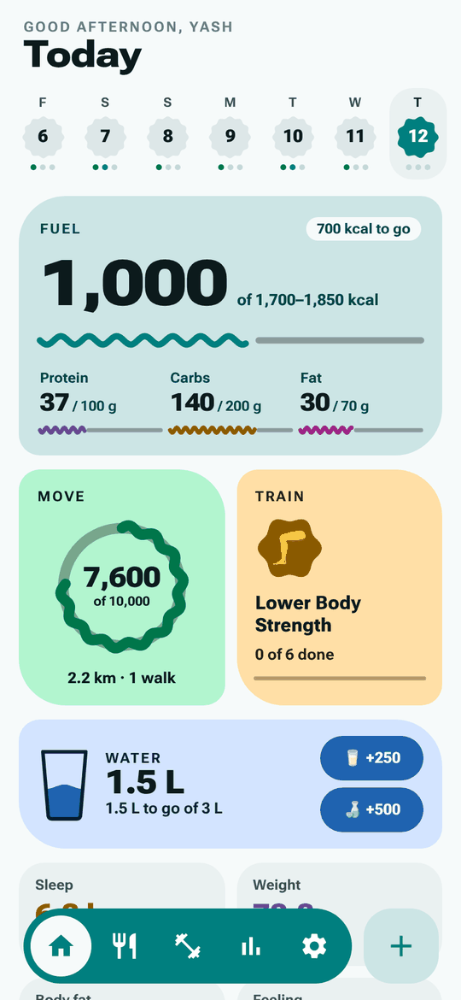 | 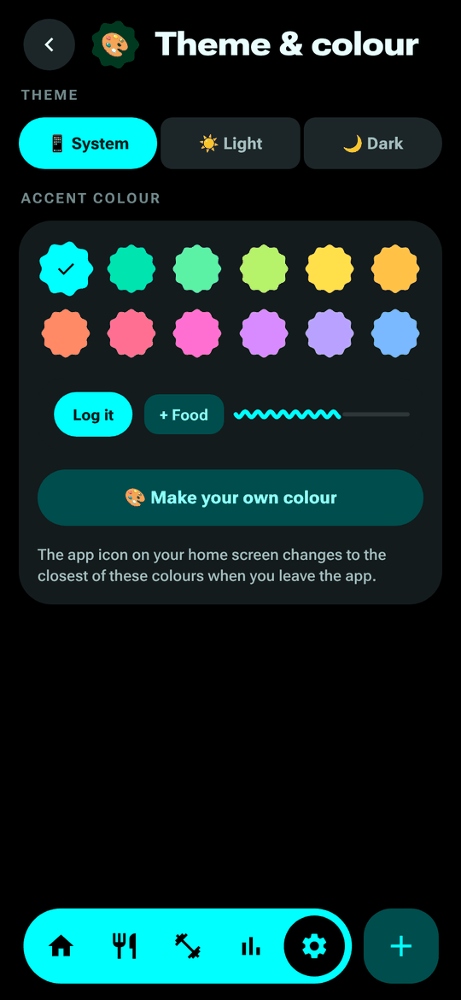 | 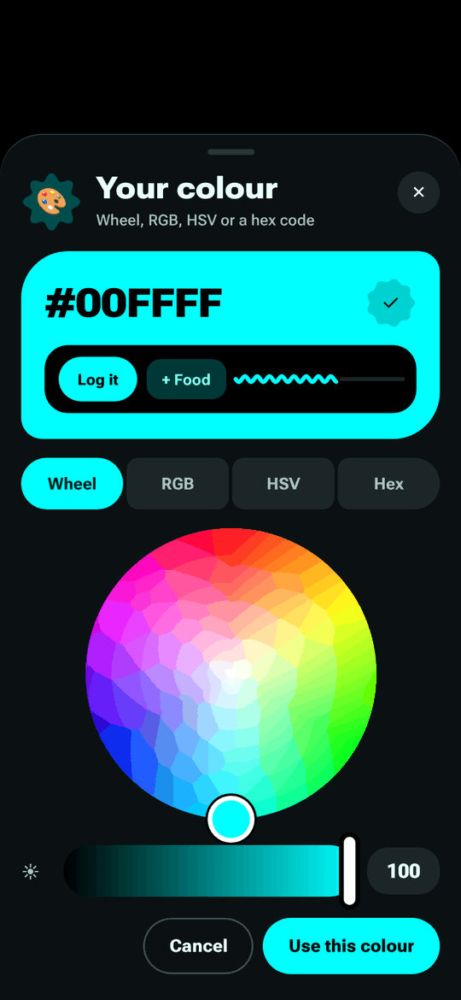 |

Water reminders work with the app closed and have **+250 ml** and **+500 ml** buttons on the notification. Backups can be saved to Drive or restored.

Screenshots come from the automated test run and use sample data.

## Install
1. On your phone, open **[Releases → latest](https://github.com/yashgumaste/fitness-tracker/releases/latest)** and download `FitnessTracker-1.x.apk`.
2. Open the file. If Android asks, allow your browser or file manager to install apps.
3. Follow the short setup. You can skip any page and change it later in Settings.

## Updates
The app checks for new versions each time you open it. When one is out, Home shows **Version 1.x is out → Update**, which downloads the new APK; open it to install. You can also tap **Settings → About & updates → Check for updates**.
Updates install over the old version and keep your data.

## How it's built
Changes are committed during the day. Every night at 2:00 AM IST, `.github/workflows/android.yml` runs, but only if there are new commits. It:
1. compiles `src/app.html` (React + JSX) into `www/` with esbuild and bundles React and the fonts locally;
2. runs `tests/smoke.cjs`, which opens the app in a headless phone-sized browser and goes through every page and log panel. If anything fails, nothing is published;
3. creates the Android project with Capacitor and applies `scripts/patch-android.cjs`;
4. builds the APK, signs it with the release key from the repository's secrets (it is never stored in the code), and publishes it as a release (nightly beta).

A build can also be started by hand from the Actions tab (**Run workflow**).

## Where things live
- `src/app.html`: the whole app (UI, logic, styles)
- `src/native.js`: phone features, including on-device storage, AI calls (Gemini or Claude), water reminders, Health Connect, backup sharing, the back button and the app icon
- `native/`: the Android plugins (`HealthConnectPlugin.kt`, `AppIconPlugin.java`)
- `scripts/`: the web build, the Android patching and the launcher icon generation
- `tests/smoke.cjs`: the nightly smoke test
- `docs/screenshots/`: the images in this README

## Privacy
- Your logs stay on your phone, plus Android's own Google backup. There is no server and no account.
- **AI:** the meal text you type and a summary of your day are sent to the AI you pick, either Google Gemini (the free default) or Anthropic Claude (with your own key). Google may use what's sent on the free tier to improve its products.
- **Health Connect** is only used if you turn it on, and only for the record types you allow.
- Your own API key is stored only on your phone.

## Building it yourself
The workflow needs three repository secrets: `GEMINI_FREE_KEY` (optional, the built-in free AI), and `KEYSTORE_BASE64` and `KEYSTORE_PASSWORD` (your signing key, base64-encoded, with alias `fitness`). A fork signed with a different key can't update this app's installs; that's what keeps updates safe.
